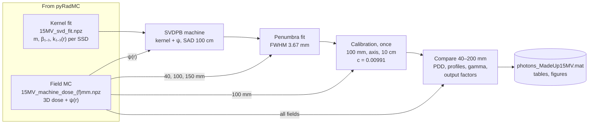
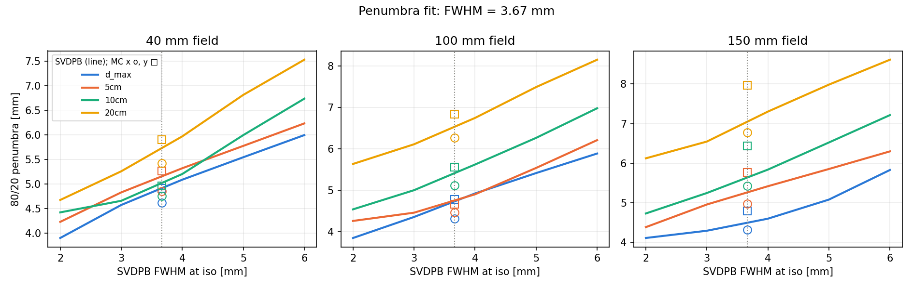
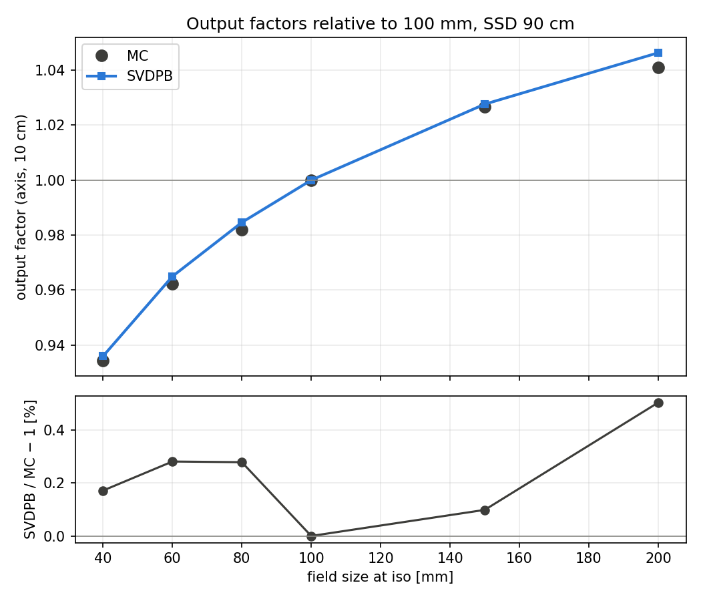
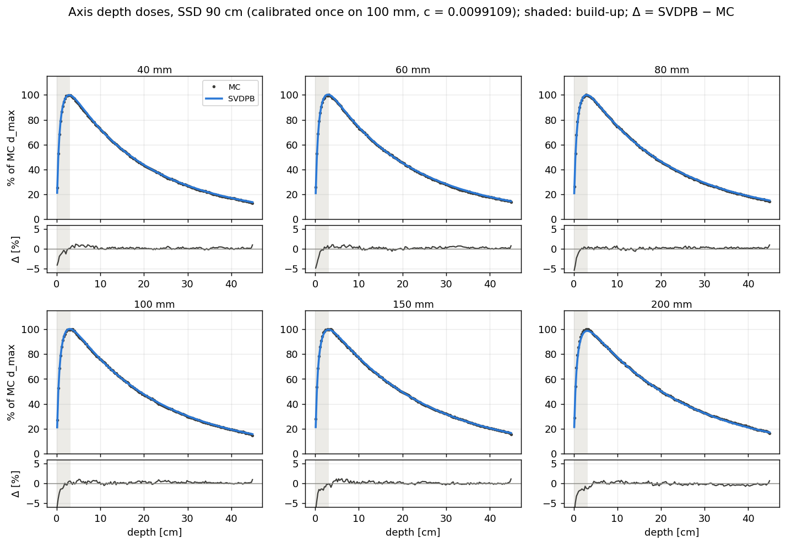
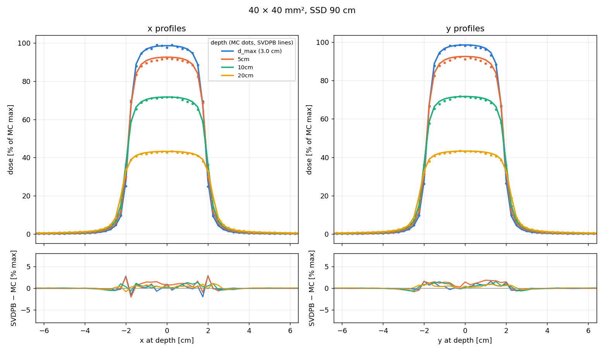
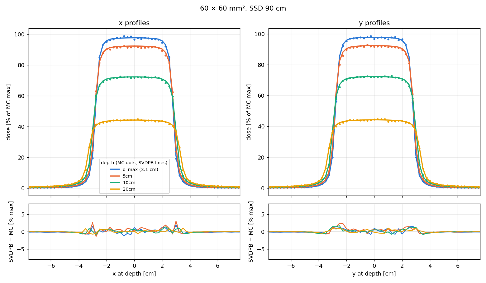
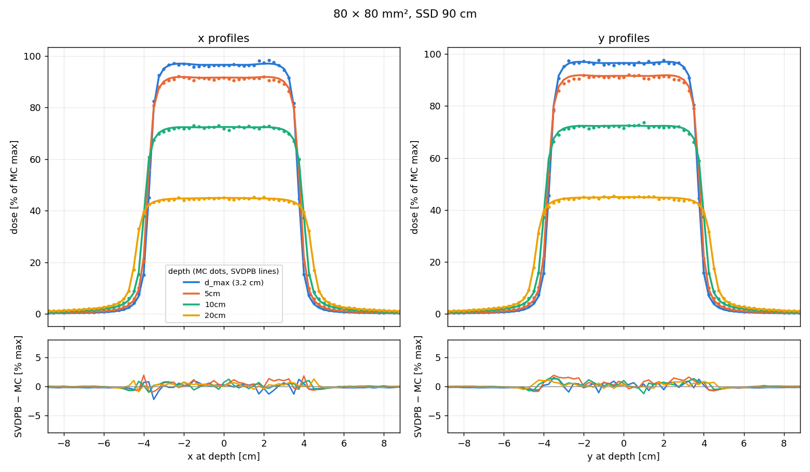
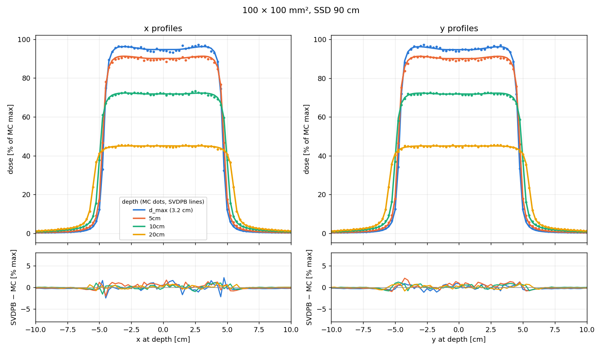
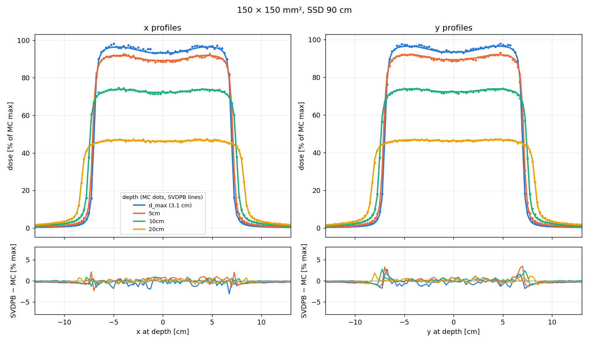
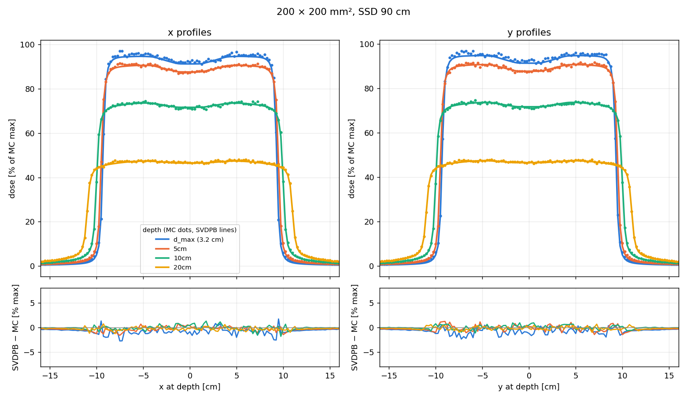

# 15 MV SVD pencil-beam commissioning: the pyRadPlan side

This folder holds the pyRadPlan half of the 15 MV study: a pyRadPlan SVD pencil-beam
(SVDPB) machine built from a pyRadMC kernel fit, and its test against full Monte Carlo
(MC) dose for six square fields from 40 to 200 mm. The pyRadMC half (pencil kernel, SVD
fit, field MC) is documented in pyRadMC's `examples/15MV_results/README.md`. Everything
here is produced by one script, [`examples/mc_pyradmc_vs_svdpb_15MV.py`](../mc_pyradmc_vs_svdpb_15MV.py).

**Result in one line:** with one fitted penumbra and one calibration factor, the machine
reproduces the MC within 0.3–0.4 % rms on the axis beyond d_max, within 0.5 % in output
factor, and with 97.6–98.6 % gamma pass rates (2 %/2 mm) for every field.



## The model

pyRadPlan's SVDPB engine (Bortfeld, Schlegel & Rhein 1993) computes

$$D(z, r) = c\left(\frac{\mathrm{SAD}}{\ell}\right)^2 \sum_{i=1}^{3} A_i(z)\,
\big[(T\cdot\psi) \otimes G_\text{penumbra} \otimes k_i\big](r),
\qquad A_i(z) = \frac{\beta_i}{\beta_i - m}\left(e^{-mz} - e^{-\beta_i z}\right)$$

with depth z, lateral position r projected to the isocentre plane, and ℓ = SSD + z. Each
part has its own place in the workflow:

| Part | What it represents | Where it comes from |
|---|---|---|
| m, βᵢ, kᵢ(r) (kernel) | Scatter and attenuation in water | pyRadMC SVD fit |
| ψ(r) (primary fluence) | In-air profile of the open beam, horns included | pyRadMC files (same table as the MC) |
| G_penumbra (Gaussian) | Blurring before the water: focal spot, leaf ends | Fitted here to MC profiles |
| T (aperture) | The field: 1 inside, 0 outside | The plan (open-field ray, bixels or MLC shapes) |
| c (calibration) | Unit conversion SVDPB → MC dose | Fitted here on one field |

Only the aperture T depends on the field, and it comes from the plan, so the machine
holds no field-specific data. The field-size dependence of the dose (the
output factors, the penumbra growing with field size and depth) has to come out of the
convolution of the aperture with the kernel. That is what the comparison tests.

## Input data

The script needs two kinds of file from pyRadMC, both in one folder (`--data-dir`):

1. **`15MV_svd_fit.npz`**: `m_per_mm`, `betas_per_mm`, `kernel_pos_mm` (0.5 mm grid),
   `kernel_ssds_mm` (500–1000 mm in 10 mm steps), `kernel_data` (n_SSD, 3, n_pos) in the
   1/mm² convention, and `sad_mm`.
2. **`15MV_machine_dose_<field>mm.npz`**, one per field: the MC dose per unit primary
   fluence on the axis at the isocentre plane (MeV/g per photon/cm²), its grid, SSD 90 cm,
   SAD 100 cm, the field size, and the ψ(r) table used. All files must carry the
   identical ψ(r); the script stops otherwise. Fields below 40 mm are skipped
   (`MIN_FIELD_MM`).

## Building the machine

The script copies pyRadPlan's generic photon machine and replaces its kernel with a
15 MV `PhotonSVDKernel` from the fit and the MC's ψ(r), with SAD 100 cm. The fit is
already in the version-2 (1/mm²) kernel convention, so the machine is saved with
`version: 2`; a machine without it is read as version 1 and its kernels are multiplied
by 4.

## Geometry and forward dose

- A water phantom on exactly the MC grid (2.5 mm voxels), with 4 air voxels in front so
  the ray tracer sees the surface. Surface at SSD 90 cm, so 10 cm depth is the isocentre.
- One open field per run: the `photonOpenFields` generator makes a single ray whose
  width is the field size. `use_custom_primary_photon_fluence=True` applies ψ(r).
- Kernels are taken at the central ray's SSD (900 mm).
- Frames: MC (x, y, z) ↔ LPS (x, z, y + SAD). x is the leaf-travel (crossplane)
  direction, y the leaf-side (inplane) direction.

## Penumbra fit

The Gaussian FWHM at the isocentre is the only free parameter not covered by the kernel
fit. It is fitted to 24 MC 80/20 penumbrae: the 40, 100 and 150 mm fields, x and y, at
d_max, 5, 10 and 20 cm. SVDPB is computed at FWHM = 2, 3, 4, 5 and 6 mm, each penumbra is
interpolated in between, and the FWHM with the smallest sum of squared differences wins.

**Result: FWHM = 3.67 mm**, rms difference 0.35 mm. The fit uses relative profiles, so it
does not depend on the calibration.

The Gaussian is not field-size dependent, and should not be: the widening of the penumbra
with field size and depth is phantom scatter, which comes from the kernel.



## Calibration

Both engines give dose per unit primary fluence on the axis at the isocentre, but per
different area: the MC per photon/cm², SVDPB (beam weight 1) per photon/mm². One factor
converts between them:

$$c = \frac{D_{MC}(100\,\mathrm{mm},\ \mathrm{axis},\ 10\,\mathrm{cm})}{D_{SVDPB}(100\,\mathrm{mm},\ \mathrm{axis},\ 10\,\mathrm{cm})} = 0.0099109$$

averaged over 3 × 3 × 2 voxels around the point. The expected value is 1/100
(cm² vs mm²); the 0.9 % offset is the absolute error of the kernel fit.

c is taken from the 100 mm field only and applied unchanged to every other field. Fitted
per field, it would absorb exactly the field-size dependence under test. The saved
machine keeps the kernels as fitted and records c in its description.

## Output factors

Dose on the axis at 10 cm depth, relative to the 100 mm field, for the same primary
fluence. The axis column is the mean of 3 × 3 voxels, averaged over 9–11 cm depth to
suppress MC noise. c cancels in the ratio, so this tests only how SVDPB's dose changes
with field size. These are at SSD 90 cm and 10 cm depth, not the clinical SSD 95 cm / 5 cm.

| Field (mm) | OF MC | OF SVDPB | SVDPB / MC − 1 |
|---:|---:|---:|---:|
| 40 | 0.9343 | 0.9359 | +0.17 % |
| 60 | 0.9623 | 0.9650 | +0.28 % |
| 80 | 0.9819 | 0.9846 | +0.28 % |
| 100 | 1 | 1 | ref. |
| 150 | 1.0266 | 1.0276 | +0.10 % |
| 200 | 1.0411 | 1.0463 | +0.51 % |



The values differ slightly from the "D(10 cm) / D₁₀₀(10 cm)" column of the pyRadMC
summary, which uses its own averaging; the comparison here uses the same voxels for both
engines.

## Results

| Field (mm) | d_max MC / SVDPB (cm) | PDD10 MC / SVDPB (%) | 80/20 at 10 cm, MC x / y vs SVDPB (mm) | Axis rms, build-up (%) | Axis rms, beyond d_max (%) | Gamma pass, all / beyond d_max (%) |
|---:|---:|---:|---:|---:|---:|---:|
| 40 | 3.00 / 3.11 | 72.5 / 72.5 | 4.8 / 5.0 vs 5.0 | 1.8 | 0.4 | 98.5 / 99.1 |
| 60 | 3.11 / 3.16 | 73.7 / 73.7 | 4.8 / 5.3 vs 5.2 | 2.1 | 0.4 | 98.6 / 99.5 |
| 80 | 3.18 / 3.19 | 74.5 / 74.7 | 5.0 / 5.3 vs 5.3 | 2.1 | 0.3 | 98.6 / 99.6 |
| 100 | 3.19 / 3.25 | 76.0 / 75.8 | 5.1 / 5.6 vs 5.4 | 2.2 | 0.4 | 98.6 / 99.7 |
| 150 | 3.10 / 3.30 | 77.1 / 77.3 | 5.4 / 6.4 vs 5.6 | 2.6 | 0.4 | 98.5 / 99.7 |
| 200 | 3.18 / 3.32 | 76.9 / 78.4 | 5.6 / 5.9 vs 5.8 | 3.1 | 0.4 | 97.6 / 99.1 |

- d_max is the vertex of a parabola through ±1.5 cm around the peak.
- Axis differences are calibrated SVDPB − MC, in % of the field's MC d_max dose; "beyond
  d_max" runs to 30 cm.
- Gamma is global 3D 2 %/2 mm, inside 80 % of the projected field, for voxels above 10 %
  of the MC maximum.
- Every quantity per field and depth is in [`summary.csv`](summary.csv).

### Depth doses



The build-up (shaded) is judged separately: the 3-component kernel fit itself is 2–4 %
off there, putting d_max 0.1–0.2 cm too deep.

### Profiles per field

x and y profiles at d_max, 5, 10 and 20 cm (MC dots, SVDPB lines), with the difference
below.

| | |
|---|---|
|  |  |
|  |  |
|  |  |

## What is saved

| File | Content |
|---|---|
| `photons_MadeUp15MV.mat` | The machine as a matRad-style `machine` struct (version 2): kernels per SSD, m, βᵢ, ψ(r), `penumbraFWHMatIso` = 3.67 mm, SAD 100 cm. The script checks it reads back unchanged |
| `summary.csv` | All metrics per field: d_max, PDDs, widths and penumbrae at each depth, axis and profile rms, gamma, output factor; plus FWHM and c |
| `output_factors.csv` | The output-factor table above |
| `*.png` | The figures on this page |

The machine file contains no field-size data: the machine's `of` and `tpr` fields are not
used by pyRadPlan, and the field enters only through the plan.

To use the machine:

```python
from pyRadPlan.machines import load_machine

pln.machine = load_machine("examples/15MV_svdpb_results/photons_MadeUp15MV.mat")
```

or run the script once with `--register-machine`, after which it loads by name as
`PhotonPlan(machine="MadeUp15MV")`.

## Limitations

- **Penumbra shape.** One isotropic Gaussian cannot follow the MC's wider y penumbra (leaf
  sides vs leaf ends) or its faster growth with depth: at 20 cm in the 150 mm field the MC
  y penumbra is 8.0 mm, SVDPB 7.0 mm.
- **Head scatter.** The MC includes collimator scatter; SVDPB has no head-scatter model.
  The output-factor agreement suggests it is small in this jawless head.
- **Leakage.** The aperture mask T has no leaf transmission, so the dose far outside the
  field is not compared.
- **Cross-sections.** The pencil kernel was run with pyRadMC's analytic cross-sections,
  the field MC with the EPICS tables; part of any remaining difference may come from that.

## Reproducing

From the repository root, with the pyRadMC outputs available:

```bash
python examples/mc_pyradmc_vs_svdpb_15MV.py                  # ~10 min, incl. penumbra fit
python examples/mc_pyradmc_vs_svdpb_15MV.py --penumbra 3.67  # skip the fit
```

Further options: `--data-dir DIR`, `--fields 40 100` (a subset), `--no-gamma`,
`--out-dir DIR`, `--register-machine`. Outputs are written to this folder by default.
